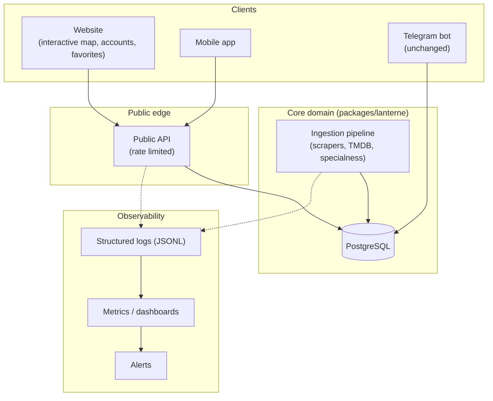

# Vision — target stack

This document describes the direction the project is heading, for context
and alignment. **Nothing described here is implemented yet** beyond the
repository structure, dockerization, and Postgres migration tracked in
[0014](decisions/0014-postgres-migration.md),
[0015](decisions/0015-uv-workspace-monorepo.md), and
[0016](decisions/0016-tests-on-postgres.md) — no business logic, no
endpoints, no UI pages, no auth, no mobile app code exists at the time of
writing. This is a plan to clarify direction, not a spec to build against
immediately.

## Today

A self-hosted Telegram bot: seven scrapers feed an `IngestionPipeline`
that enriches films via TMDB and persists deduplicated screenings; the
bot answers natural-language questions and sends a weekly digest. See
[`architecture.md`](architecture.md) for how this actually works.

## Where it's heading

### Website — interactive map, accounts, favorites

A public-facing site (Next.js, `services/web/`) that turns the same
screening data the bot already tracks into a browsable experience:

- An interactive map of Paris/IDF venues, filterable by date, special
  category, or venue.
- User accounts (email or OAuth — not designed yet) so a visitor can save
  favorite venues, films, or event types.
- Favorites drive personalized notifications, eventually replacing (or
  complementing) the Telegram-only digest with a web-native one.

### Public API — rate limited

A FastAPI service (`services/api/`) exposing the screening/film/venue
data read-only to third parties, not just the website:

- Same domain, same Postgres database, same `packages/lanterne` models —
  the API is a new consumer of the existing domain, not a parallel
  implementation.
- Rate limiting per API key/IP from day one (not retrofitted later) —
  exact mechanism (token bucket at a gateway vs. in-app middleware) to be
  decided when the API is actually built.
- Versioned (`/v1/...`) from the first real endpoint, so the mobile app
  and any third-party consumer have a stable contract to build against.

### Mobile app

A native or cross-platform client (`services/mobile/` — framework not
chosen yet: React Native and Flutter are both plausible given this
project's existing TypeScript/Next.js investment) consuming the same
public API as any other third party — no private mobile-only backend
route.

### Observability

Once there are multiple long-running services (API, bot, scrape cron,
website) instead of one bot process, structured JSONL logging
(`rules/common/logging.md`, already the project's convention) is joined
by:

- **Metrics**: request latency/error rate for the API, scrape run
  duration and per-source success/failure (the admin Telegram report
  already carries a version of this — a dashboard generalizes it).
- **Dashboards**: a single place to see "is everything healthy" across
  scraper, bot, API, and database, instead of reading logs per service.
- **Alerts**: paged on scrape failures, API error-rate spikes, or
  database issues — the `ADMIN_CHAT_ID` report is today's ad hoc version
  of this for the scraper alone.

`services/observability/` is reserved for this — no tool is chosen yet
(candidates: Grafana + Prometheus/Loki, or a hosted alternative,
consistent with `rules/devops/devops.md`'s OpenTelemetry-first stance
once this is actually built).

## Deployment shape

Single rented server, Docker Compose (no Kubernetes — out of scope at
this project's scale, see `rules/devops/devops.md`'s guidance on when
Compose is sufficient). A reverse proxy (Caddy) only enters the picture in
`docker-compose.prod.yml` (see
[ADR 0020](decisions/0020-prod-compose-overlay.md)), for TLS termination
and routing between the public API/website and the outside world — never
in local dev, where every service stays directly reachable on its own
port.

## Non-goals for now

- No functional API endpoints, website pages, or mobile screens are
  being built as part of the current repository restructuring — only the
  `services/*` scaffolding, Dockerization, and a hello-world health check
  wiring API ↔ Postgres ↔ website together end to end.
- No authentication system is designed or implemented yet.
- No specific observability tool is installed yet — only the `services/observability/`
  placeholder exists.
